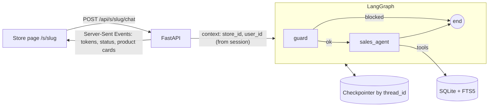

# ShopBot: an AI storefront for small sellers

A seller uploads a catalog and gets a store page with a sales assistant that answers questions, recommends items
within budget and upsells a matching add-on, using only the seller's real catalog.

Built with **FastAPI**, **LangGraph** and **Claude Haiku 5.5**. Track 1 of the *Design to Production: Agentic AI Hackathon*.

> Status: **Phase 1** (customer page, guard + sales agent, 4 catalog tools, streaming chat). Ordering, the seller
> dashboard, long-term memory and the benchmark arrive in Phase 2. See [flow.md](flow.md) and [explanation.md](explanation.md).

## Architecture (Phase 1)



## Run locally

```bash
python -m venv .venv
.venv\Scripts\activate             # macOS/Linux: source .venv/bin/activate
pip install -r requirements.txt
cp .env.example .env               # then put your ANTHROPIC_API_KEY in .env
uvicorn app.main:app --reload      # http://localhost:8000
pytest                             # offline tests, no API calls
```

Two demo stores are seeded on first start: `/s/noor-threads` and `/s/kicks-corner`. All data is fictional.

## Deploy (Render)
1. Push this folder to a public GitHub repo.
2. On Render: **New → Blueprint**, pick the repo (it reads `render.yaml`).
3. Paste `ANTHROPIC_API_KEY` when asked. `SESSION_SECRET` is generated for you.

Phase 1 stores data in SQLite inside the container, so the demo catalog reseeds on every deploy. Phase 2 moves to Postgres.
