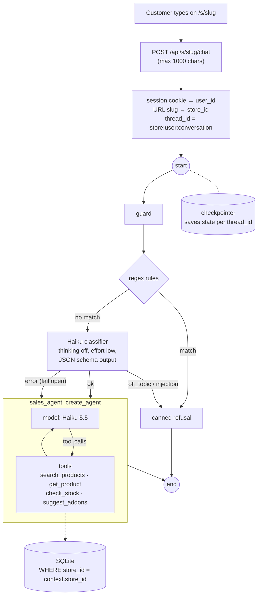
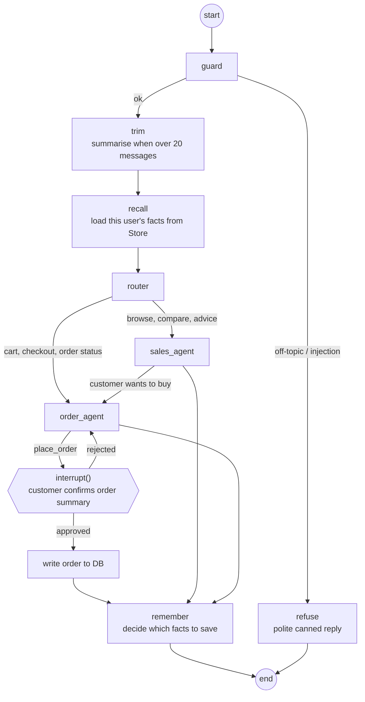
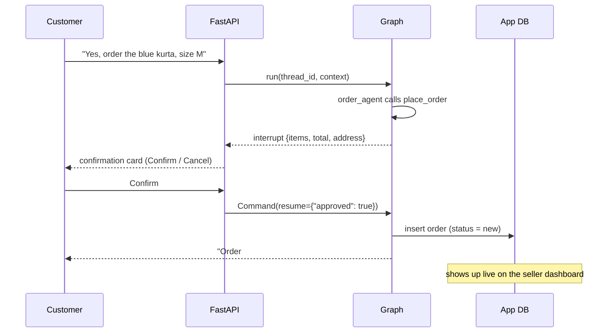
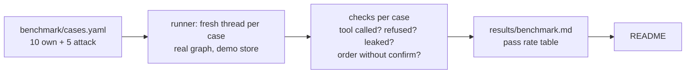
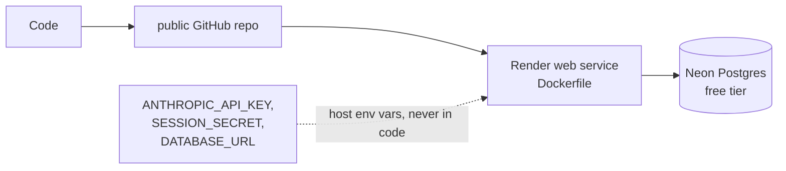

# ShopBot: flows and pipelines

> Status: **Phase 1 built** (approved plan). §0 below is what runs today; §1 to §7 are the full target design.
> The rest lands in Phase 2.

## 0. What runs today (Phase 1)

**What streams back to the browser (SSE events):**

| Event | When | UI |
|---|---|---|
| `status` | The sales agent's model requests a tool | "Searching the catalog…" spinner |
| `products` | A tool returns product cards (its artifact) | Swipeable mini cards; clicking one highlights the product in the grid |
| `token` | Each piece of the reply's text | Text appears as it's written |
| `blocked` | The guard refused the message | Dashed-border bubble |
| `error` | Model or API failure, e.g. the spend limit was reached | Friendly error bubble |
| `done` | Always last | Re-enables the input box |

**Page load:** `GET /api/s/{slug}/history` reads the checkpointer state for this customer's thread, so a refresh keeps the conversation. **New chat** starts a new `conversation` id, which means a new thread.

---

ShopBot is an AI storefront for small sellers. A seller uploads a catalog and gets a public store page with a sales agent that answers questions, recommends, upsells and takes orders. The seller dashboard shows orders and sales.

---

## 1. System overview

```mermaid
flowchart LR
    subgraph Browser
        C[Customer store page<br>/s/&#123;slug&#125;]
        A[Seller dashboard<br>/admin]
    end
    subgraph FastAPI
        R1[Chat API<br>SSE stream]
        R2[Seller API<br>auth, catalog, orders]
    end
    subgraph LangGraph
        G[ShopBot graph]
        CP[(Checkpointer<br>by thread_id)]
        ST[(Store<br>by store_id + user_id)]
    end
    DB[(App DB<br>sellers, products, orders)]
    LLM[[Claude Haiku 5.5]]

    C -- message --> R1 --> G
    G <--> CP
    G <--> ST
    G -- tools --> DB
    G <--> LLM
    A --> R2 --> DB
```

- **Who is who** comes only from the server session (signed cookie), never from the chat. FastAPI puts `store_id` and `user_id` into the LangGraph **runtime context**, and every tool reads them from there.
- `thread_id = "{store_id}:{user_id}:{conversation_id}"`. Before resuming a thread, the server checks that it belongs to the caller.

---

## 2. The agent graph (one customer turn)

| Node | Role | Uses the LLM? |
|---|---|---|
| `guard` | Blocks prompt injection and off-topic requests. Regex rules first, then a cheap Haiku classifier (structured output). | Only if the rules don't decide |
| `trim` | Short-term memory hygiene: summarise old turns into `state.summary`, delete them with `RemoveMessage`. | Only when the chat is long |
| `recall` | Loads long-term facts (size, colours, budget, past purchases) for this `user_id` in this store. | No |
| `router` | Picks the specialist agent: sales or orders. | Yes (structured output, low effort) |
| `sales_agent` | Answers, recommends, upsells. Tools: `search_products`, `get_product`, `check_stock`, `suggest_addons`, `add_to_cart`. | Yes |
| `order_agent` | Cart and checkout. Tools: `view_cart`, `place_order` (needs human approval), `order_status`, `request_cancellation`. | Yes |
| `remember` | Extracts durable facts worth saving and writes them to the Store. Skips anything sensitive. | Yes (low effort) |

---

## 3. Human-in-the-loop (risky actions)

- **Placing an order** (spending money) always pauses for the customer's explicit confirmation.
- **Cancellations, refunds and discounts** are never done by the agent. It files a request, and the seller approves it in the dashboard.

---

## 4. Seller pipelines

### 4.1 Catalog upload

```mermaid
flowchart LR
    U[Seller uploads CSV/JSON] --> V[validate rows<br>name, price, stock, sizes, tags]
    V -- errors --> E[show row errors]
    V -- ok --> W[upsert products<br>WHERE store_id = seller]
    W --> I[rebuild search index<br>SQLite FTS5]
    I --> P[store page live at /s/&#123;slug&#125;]
```

### 4.2 Dashboard
- **Orders:** new → confirmed → shipped → delivered. The seller moves each order along.
- **Sales:** revenue today, this week and in total, top products, conversion (chats that became orders).
- **Approvals:** the cancellation and refund requests the agent filed.
- **Catalog:** products, stock, re-upload.

---

## 5. Memory

| | Short-term | Long-term |
|---|---|---|
| Key | `thread_id` | namespace `(store_id, user_id, "facts")` |
| Holds | messages, summary, cart, pending order | size, colour and style preferences, budget range, past purchases |
| Where | LangGraph checkpointer (SQLite locally, Postgres in production) | LangGraph Store (same DB) |
| Trimming | `trim` node summarises after 20 messages | `remember` dedupes and overwrites facts by key |
| Never saved | n/a | card or bank numbers, CNIC, passwords, phone, full address, anything from a blocked message |

---

## 6. Benchmark pipeline

---

## 7. Deploy pipeline

